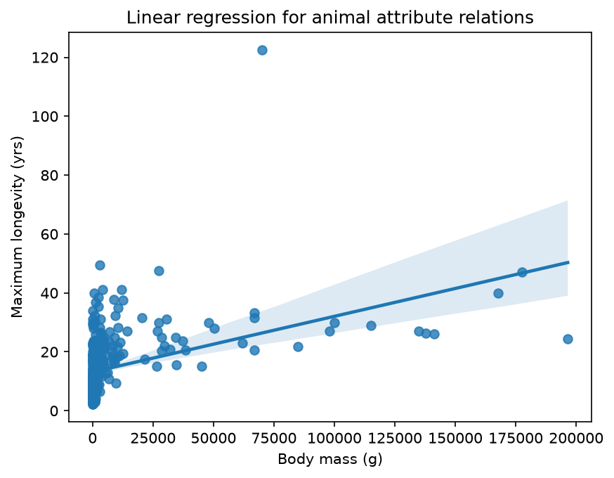

# TIAN ZINING

Hi, I'm TIAN ZINING, a student in CISC7204 (Data Visualization) at the University of Macau. I enjoy turning raw data into clear visual stories with Python — from tabular statistics to geospatial maps.

## Technical Skills

- Python: pandas, numpy, matplotlib, seaborn
- Statistical visualization: regression plots, heatmaps, box/violin plots, treemaps
- Geospatial visualization: geoplotlib (dot-density maps, histograms, Voronoi, Delaunay)
- Jupyter Notebook workflows and reproducible analysis

## Project Showcase

### Body Mass vs Maximum Longevity in Mammals

**Research question:** Do larger mammals live longer? This project examines the relationship between a species' body mass and its maximum recorded longevity using the AnAge database.

**Visualization:**

**Findings:** Heavier mammal species tend to live longer (Pearson correlation ≈ 0.43), but the relationship is noisy — body size alone does not predict lifespan, and the distribution of longevity is strongly right-skewed.

**Repository:** [github.com/TIANZINING/data-science-project](https://github.com/TIANZINING/data-science-project)

**Status:** Completed
