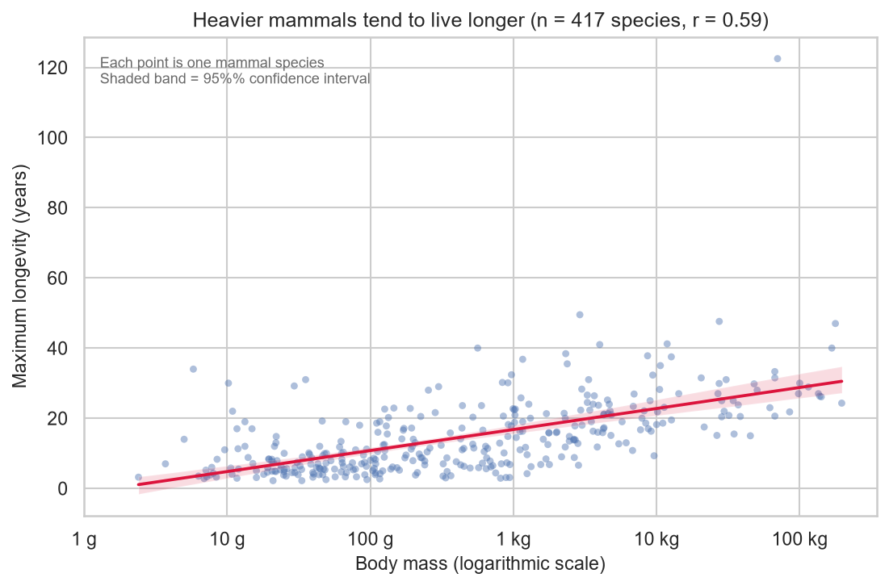
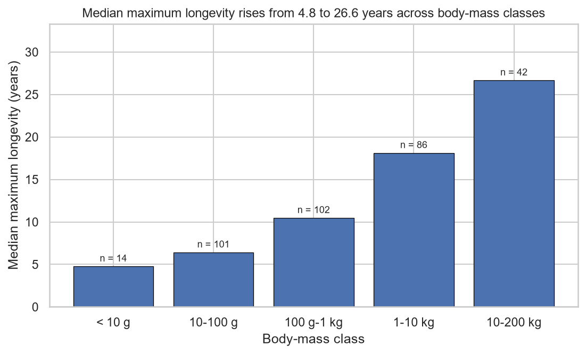

# TIAN ZINING — Data Science Portfolio

## About Me

I am a student in CISC7204 (Data Science and Data Visualization) at the University of Macau. I use Python
to turn tabular data into clear, reproducible analyses and visuals. My current work focuses on exploratory
data analysis, statistical reasoning and honest reporting of what a dataset can and cannot show.

## Technical Skills

- Python: pandas, NumPy, matplotlib, seaborn, Jupyter
- Exploratory data analysis: distributions, correlations, group comparisons
- Statistics: PMFs, CDFs, percentile and interquartile measures, hypothesis testing
- Data visualisation: regression plots, box and violin plots, bar charts with annotated sample sizes,
  logarithmic scales, geospatial mapping
- Workflow: Git and GitHub, reproducible notebooks, README documentation

## Featured Project: Body Mass vs Maximum Longevity in Mammals

### Research Question

Do heavier mammal species live longer, and how strong is that association?

### Approach

I loaded an extract of the AnAge database (4,218 records) and filtered it to 417 mammal species with body
mass under 200,000 g. I measured the association three ways — Pearson correlation on raw body mass, on
log10 body mass, and Spearman rank correlation — then visualised the relationship with a fitted regression
line and compared median longevity across five body-mass classes.

### Visualisation

### Findings

- Median maximum longevity rises monotonically from **4.8 years** for species under 10 g to **26.6 years**
  for species of 10–200 kg.
- The association is stronger on a logarithmic scale: **r = 0.59** for log10 body mass and **rho = 0.65**
  (Spearman), against **r = 0.43** for raw mass, so body mass acts multiplicatively on lifespan.
- The association is moderate, not tight: longevity still spans roughly 2 to over 100 years inside a single
  mass class.

### Limitation

The analysis is observational and uses one curated database. Correlation does not imply causation, records
differ in data quality and provenance, and the 200,000 g cut-off excludes the largest mammals such as
elephants and whales. The results describe this sample rather than all mammals.

### Project Repository

[View the code and README](https://github.com/TIANZINING/data-science-project)

### Status

Completed.

## Peer Feedback and Response

A classmate reviewed the first version of this portfolio and pointed out that the charts did not explain
what the measurements represented: the scatter plot had no axis labels, no units and no stated sample size,
so a reader could not tell what the numbers meant.

I responded by rebuilding both figures — axis labels with units (grams, kilograms, years), a title that
states the finding and the sample size, a logarithmic body-mass axis ticked in grams and kilograms, an
annotation describing the confidence band, and a second chart comparing median longevity across body-mass
classes with the sample size on each bar. The README was rewritten to match: dataset source and permissions,
methods, findings with the actual correlation values, limitation, and run instructions.

The change is committed in `data-science-project` as
**"Improve figures: axis labels, units and a median-by-mass-class chart"** (commit `21594d0` on `main`).

## Contact

- GitHub: [github.com/TIANZINING](https://github.com/TIANZINING)
- Email: mc64176@um.edu.mo
